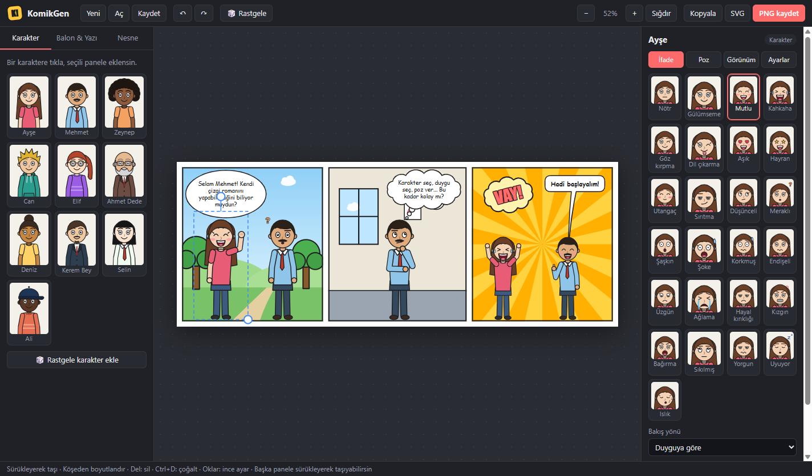
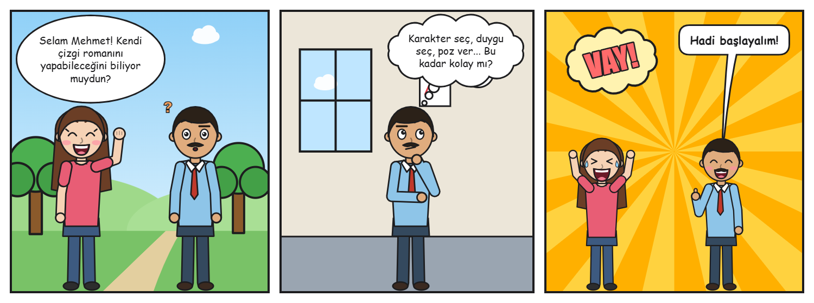

# KomikGen

[Gramener Comicgen](https://gramener.com/comicgen/)'den esinlenen, Windows için masaüstü çizgi roman oluşturma uygulaması (Electron).



Örnek çıktı:



## Özellikler

- **10 hazır karakter** + rastgele karakter üretici
- **25 duygu/ifade**: mutlu, kahkaha, üzgün, ağlama, kızgın, şaşkın, şoke, aşık, hayran, uykulu…
- **19 poz**: el sallama, işaret etme, eller belde, kollar bağlı, düşünme, kahve içme, telefon, kitap, pano tutma, koşma…
- **Görünüm düzenleme**: ten rengi, saç modeli/rengi, üst giyim, pantolon, ayakkabı, gözlük, sakal/bıyık, şapka
- Bakış yönü, bacak duruşu, aynalama, döndürme, boyutlandırma
- **6 balon tipi**: oval konuşma, kutu, düşünce, bağırma, fısıltı, anlatıcı kutusu (sürüklenebilir kuyruk)
- **Efekt yazıları**: POW!, BOOM!, VAY!…
- **Nesneler**: masa, sandalye, dizüstü, bitki, ağaç, kedi, ampul… ve bilgisayardan resim ekleme
- **14 arka plan**: park, şehir, gece, ofis, sınıf, oda, plaj, aksiyon ışınları, hız çizgileri, pop-art, kendi resmin…
- **10 panel düzeni**, sayfa boyutu, panel aralığı, çerçeve ve köşe ayarları
- Öğeleri paneller arasında sürükleyerek taşıma
- Geri al / yinele, çoğaltma, katman sırası
- **Dışa aktarma**: PNG (2x), JPG, SVG, panoya kopyalama
- Projeyi `.komik` dosyası olarak kaydetme/açma

## Çalıştırma

```bash
npm install
npm start
```

> npm 11 kurulum betiklerini engellerse Electron ikili dosyası inmez. O zaman bir kez
> `node node_modules/electron/install.js` komutunu çalıştırın.

## Tek dosyalık .exe oluşturma

```bash
npm install --save-dev electron-builder
npm run dist
```

Çıktı `dist/` klasörüne taşınabilir (portable) bir `KomikGen.exe` olarak düşer.

## Kısayollar

| Kısayol | İşlev |
| --- | --- |
| Ctrl+N / Ctrl+O / Ctrl+S | Yeni / Aç / Kaydet |
| Ctrl+E | PNG olarak dışa aktar |
| Ctrl+Shift+C | Resmi panoya kopyala |
| Ctrl+Z / Ctrl+Y | Geri al / Yinele |
| Ctrl+D | Seçileni çoğalt |
| Delete | Seçileni sil |
| Oklar (Shift ile 10 px) | İnce konumlandırma |
| Ctrl + fare tekerleği | Yakınlaştır / uzaklaştır |
| Shift + balonu sürükle | Kuyrukla birlikte taşı |
| Shift + döndürme | 15°'lik adımlarla döndür |

## Dosya yapısı

```
main.js            Electron ana süreç: pencere, menü, dosya diyalogları
preload.js         Arayüze güvenli IPC köprüsü
src/index.html     Arayüz iskeleti
src/styles.css     Tema
src/characters.js  SVG karakter motoru (yüz, duygu, poz, kıyafet)
src/scene.js       Arka planlar, nesneler, balonlar, efektler
src/app.js         Editör: durum, sürükle-bırak, özellik paneli, kaydet/dışa aktar
```

Karakter çizimlerinin tamamı bu projede SVG olarak sıfırdan üretilmiştir; Comicgen'in görselleri kullanılmamıştır.
